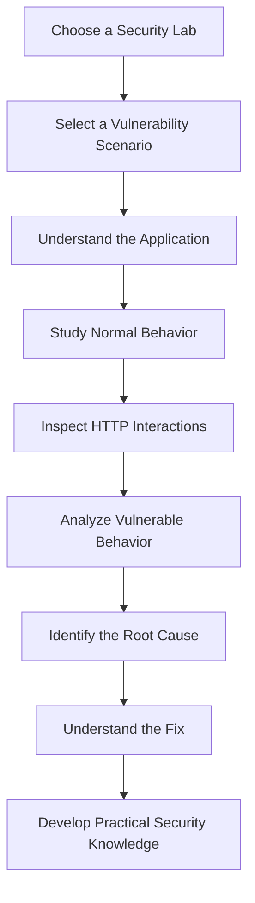
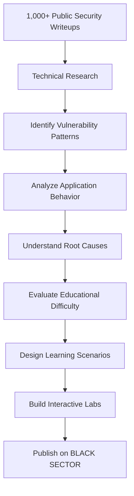
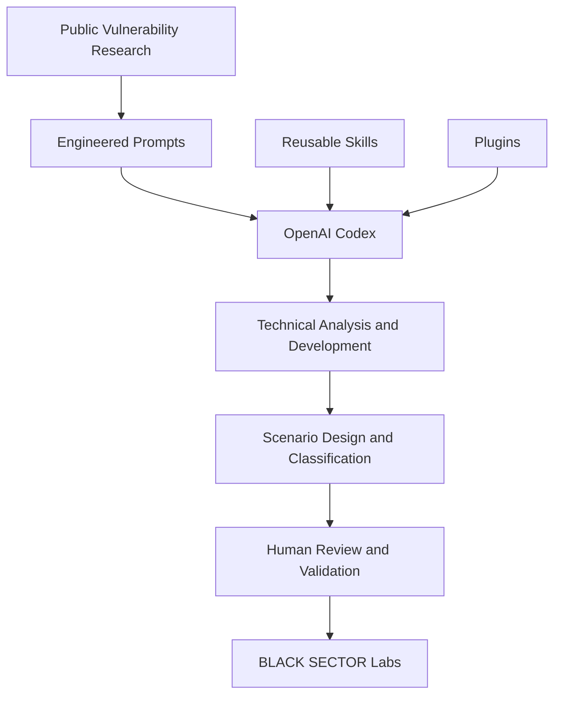
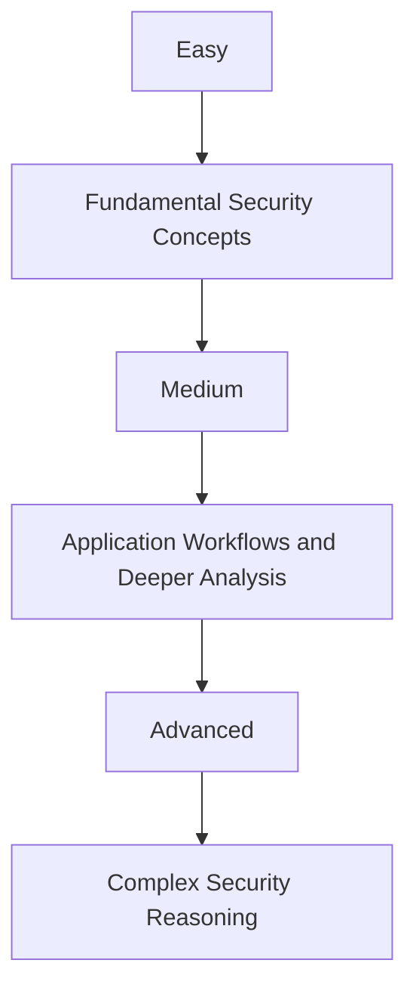
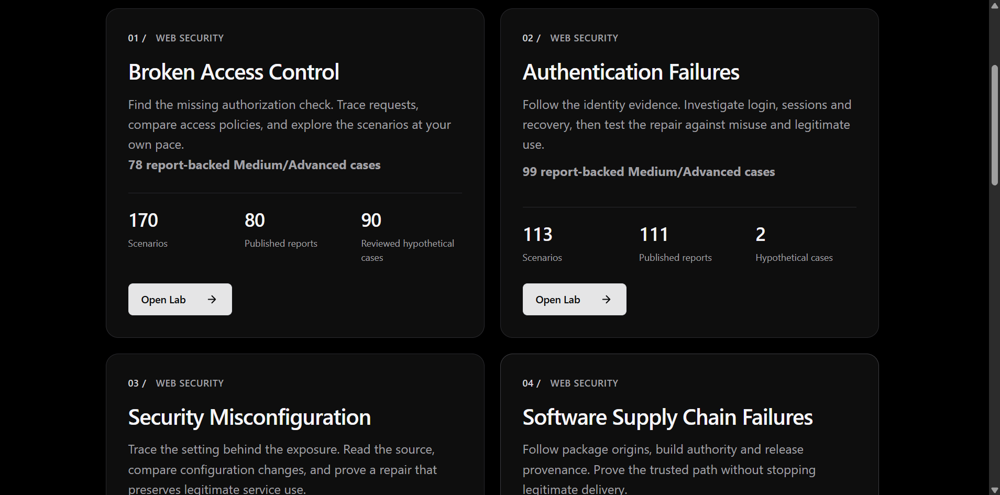
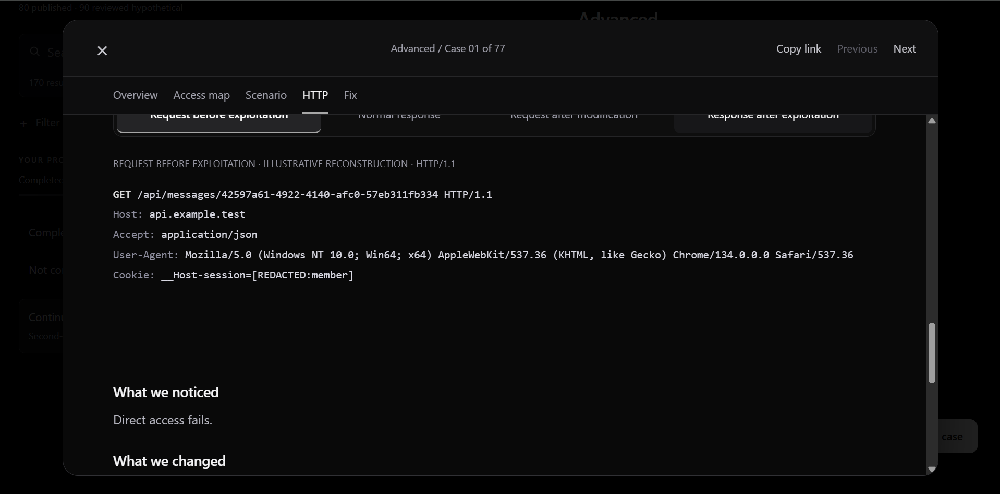
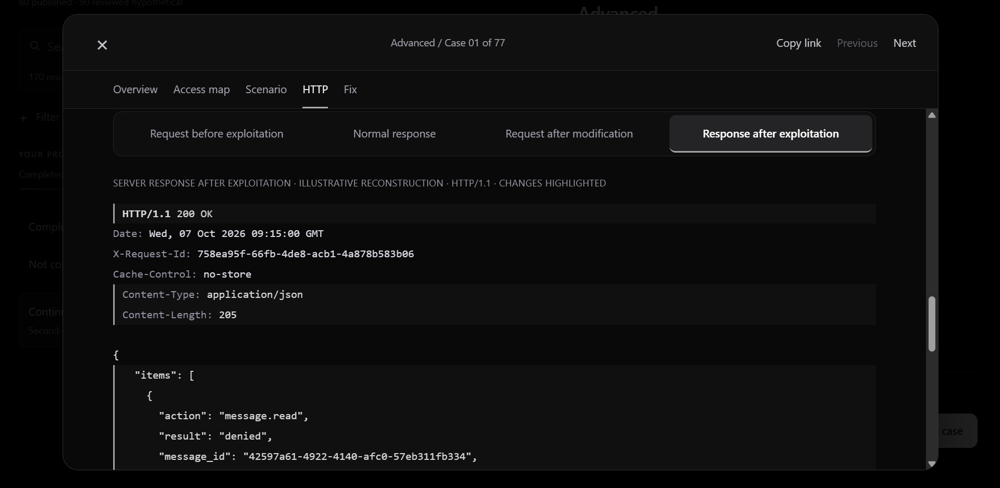
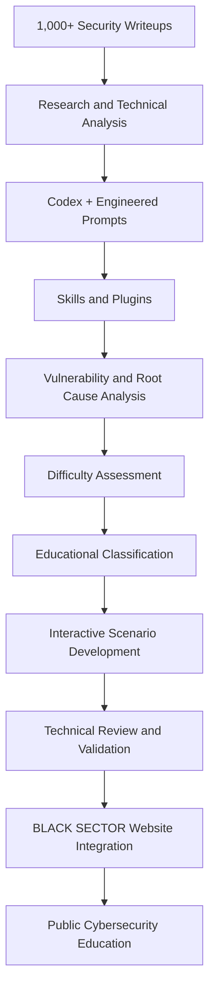

# BLACK SECTOR × OpenAI Codex

### From 1,000+ Real-World Security Writeups to Interactive Cybersecurity Labs

**Real-World Research · OpenAI Codex · Engineered Prompts · Skills & Plugins · Practical Cybersecurity Education**

BLACK SECTOR is an independent cybersecurity education platform that transforms real-world vulnerability research into structured, interactive learning experiences.

Using **OpenAI Codex, carefully engineered prompts, reusable Skills, and Plugins**, we developed a research-to-development methodology built around the analysis of more than **1,000 publicly available vulnerability writeups**.

Our objective was not simply to collect vulnerabilities or generate explanations.

We wanted to understand **why vulnerabilities occur, how applications are supposed to behave, what changes when security controls fail, and how those concepts can be taught effectively**.

We used these insights to develop, organize, and classify educational scenarios, then integrated the resulting interactive Labs into the BLACK SECTOR website.

**The final result is publicly accessible for cybersecurity learners.**

### Explore the Live Project

**[OPEN BLACK SECTOR INTERACTIVE LABS](https://blacksector.cc/labs/)**

**Official Website:** https://blacksector.cc

---

## Table of Contents

1. [Project Overview](#project-overview)
2. [What Are BLACK SECTOR Labs?](#what-are-black-sector-labs)
3. [The Research Foundation](#the-research-foundation)
4. [How We Used OpenAI Codex](#how-we-used-openai-codex)
5. [Prompt Engineering, Skills and Plugins](#prompt-engineering-skills-and-plugins)
6. [AI-Assisted Vulnerability Classification](#ai-assisted-vulnerability-classification)
7. [Inside an Interactive Lab](#inside-an-interactive-lab)
8. [BLACK SECTOR Labs — Screenshots](#black-sector-labs--screenshots)
9. [Normal vs. Vulnerable Behavior](#normal-vs-vulnerable-behavior)
10. [Connecting Labs to Original Research](#connecting-labs-to-original-research)
11. [Complete Development Workflow](#complete-development-workflow)
12. [From Research to a Public Platform](#from-research-to-a-public-platform)
13. [Educational Value](#educational-value)
14. [Technical Accuracy and Quality Control](#technical-accuracy-and-quality-control)
15. [Lessons Learned](#lessons-learned)
16. [Future Development](#future-development)
17. [Frequently Asked Questions](#frequently-asked-questions)
18. [Explore BLACK SECTOR](#explore-black-sector)

---

## Project Overview

### What Is BLACK SECTOR?

BLACK SECTOR is a cybersecurity education platform focused on practical learning, realistic vulnerability scenarios, and technical understanding.

The platform is designed for students, penetration testers, developers, security researchers, and cybersecurity enthusiasts who want to understand how real-world application vulnerabilities occur.

Our educational philosophy is simple:

> **Understand how an application is supposed to work before studying how it can fail.**

Many vulnerability explanations focus on exploitation techniques without fully explaining the application's intended functionality or security boundaries.

BLACK SECTOR approaches this differently.

We want learners to understand:

- How an application normally behaves.
- What legitimate application requests look like.
- Which security controls should exist.
- What changes when a vulnerability is introduced.
- Why the vulnerable behavior occurs.
- Which implementation mistake causes the weakness.
- How the issue can be identified and analyzed.
- How developers can prevent similar vulnerabilities.

### Project Highlights

| Area | Description |
|---|---|
| Research | More than 1,000 real-world vulnerability writeups analyzed |
| AI Development | OpenAI Codex |
| AI Workflow | Engineered prompts, Skills, and Plugins |
| Educational Product | Interactive cybersecurity Labs |
| Learning Method | Normal vs. vulnerable application behavior |
| Technical Content | HTTP requests, responses, root causes, and fixes |
| Classification | Easy, Medium, and Advanced |
| Research References | Public vulnerability reports and writeups |
| Deployment | Integrated into BLACK SECTOR |
| Access | Public educational website |

**Important:** The 1,000+ figure refers to researched security writeups, not the number of individual Labs or scenarios published on BLACK SECTOR.

---

## What Are BLACK SECTOR Labs?

BLACK SECTOR Labs are interactive educational modules designed to help learners understand cybersecurity vulnerabilities through structured technical scenarios.

Instead of presenting a vulnerability as an isolated definition or exploitation technique, each Lab examines the relationship between the application's intended functionality, vulnerable behavior, and underlying security failure.

### The Learning Model



### What Students Learn

**Application Context**

Understand the affected functionality and the behavior expected from the application.

**Normal Behavior**

Study how legitimate requests should be processed and which security boundaries should be enforced.

**Vulnerable Behavior**

Observe how a missing or incorrectly implemented security control changes application behavior.

**HTTP Analysis**

Examine realistic HTTP requests and responses to understand the technical differences between expected and vulnerable interactions.

**Root Cause Analysis**

Identify the implementation mistake responsible for the weakness.

**Security Remediation**

Understand how the vulnerability could be prevented through appropriate security controls.

### Interactive Learning

The Labs provide an environment where learners can explore realistic vulnerability scenarios and study the technical reasoning behind them.

The goal is not simply to memorize exploitation steps.

**The goal is to build the analytical skills required to recognize similar security weaknesses in unfamiliar applications.**

### Explore the Labs

**[Visit BLACK SECTOR Interactive Labs](https://blacksector.cc/labs/)**

---

## The Research Foundation

### More Than 1,000 Real-World Security Writeups

The foundation of our educational methodology is extensive research into publicly documented security vulnerabilities.

Our process involved studying and analyzing more than **1,000 published security vulnerability writeups**.

These reports provided technical insights into:

- Real-world application weaknesses.
- Vulnerability patterns.
- Application workflows.
- Security boundaries.
- Exploitation conditions.
- Authentication and authorization failures.
- Unexpected application behavior.
- Recurring implementation mistakes.
- Root causes and possible remediations.

Our objective was not to reproduce the reports directly.

Instead, we focused on understanding their underlying technical lessons and transforming those lessons into structured educational scenarios.

### Research Objectives

For each relevant vulnerability concept, we focused on identifying:

1. The application's intended functionality.
2. The expected security controls.
3. The legitimate application workflow.
4. The conditions required for the vulnerability to exist.
5. The abnormal behavior introduced by the weakness.
6. The technical root cause.
7. The differences between expected and vulnerable behavior.
8. The educational complexity of the scenario.
9. The most appropriate difficulty classification.
10. The value of the vulnerability as a practical learning experience.

### Research-to-Education Model



### Research Quality Over Quantity

Researching more than 1,000 writeups does not mean publishing 1,000 copies of existing reports.

Multiple reports may describe similar vulnerabilities, while others reveal unique implementation mistakes.

Our approach emphasizes:

- Identifying meaningful security concepts.
- Understanding recurring vulnerability patterns.
- Avoiding unnecessary duplication.
- Separating research-backed findings from hypothetical examples.
- Maintaining technical accuracy.
- Preserving appropriate attribution.
- Selecting scenarios with practical educational value.

**Our objective is to transform real-world security research into meaningful learning, not simply increase the number of published scenarios.**

---

## How We Used OpenAI Codex

OpenAI Codex became an important component of the BLACK SECTOR research and software development workflow.

We used Codex to support technical analysis, educational scenario design, implementation, troubleshooting, and quality review.

Rather than relying on generic instructions, we developed structured prompts with explicit technical and educational requirements.

Our methodology combined:

- OpenAI Codex.
- Carefully engineered prompts.
- Reusable Codex Skills.
- Plugins supporting relevant workflows.
- Public real-world vulnerability research.
- Human technical review.
- Iterative development and validation.

### Codex as an Engineering Assistant

**Research Organization**

Supporting structured analysis of security information and identification of relevant vulnerability concepts.

**Vulnerability Analysis**

Assisting with the interpretation of application behavior, exploitation conditions, and technical root causes.

**Scenario Design**

Helping translate technical findings into structured educational explanations and practical examples.

**Software Development**

Supporting implementation and refinement of interactive educational interfaces.

**Code Review**

Helping investigate implementation problems and explore potential improvements.

**Troubleshooting**

Analyzing technical issues and assisting with corrective approaches.

**Performance Optimization**

Supporting investigations into responsiveness, navigation, and application behavior.

**Quality Improvement**

Assisting with testing strategies, consistency checks, and iterative refinement.

Codex helped accelerate parts of this workflow, while technical judgment and verification remained essential.

---

## Prompt Engineering, Skills and Plugins

### Why Prompt Engineering Mattered

A generic prompt such as:

> Create a cybersecurity vulnerability Lab.

was not sufficient for our requirements.

We needed outputs that were technically meaningful, educationally structured, and consistent with the existing BLACK SECTOR platform.

Our prompting methodology emphasized understanding the application before attempting to explain the vulnerability.

### Our Prompting Principles

#### 1. Understand the Application

Establish the affected functionality and intended application workflow.

#### 2. Identify the Vulnerability

Understand the conditions that introduce the security weakness.

#### 3. Determine the Root Cause

Focus on the underlying engineering mistake rather than simply reproducing exploitation steps.

#### 4. Compare Application Behavior

Separate normal interactions from vulnerable interactions and explain their differences.

#### 5. Maintain Technical Accuracy

Require logically consistent technical explanations, HTTP requests, and HTTP responses.

#### 6. Evaluate Educational Difficulty

Assess the reasoning and technical knowledge required to understand the scenario.

#### 7. Preserve Educational Consistency

Maintain a structured learning format across different vulnerability categories.

#### 8. Separate Facts from Assumptions

Distinguish documented research findings from illustrative or reconstructed behavior.

#### 9. Review Before Publication

Treat AI-assisted analysis and generated implementations as outputs requiring validation.

### Codex Skills

We used reusable Skills to support specialized tasks and maintain consistent instructions across our development workflow.

These workflows supported activities involving:

- Research analysis.
- Vulnerability understanding.
- Technical explanation structure.
- Educational scenario design.
- Software development.
- Code review.
- Troubleshooting.
- Quality checking.
- Maintaining consistency between Labs.

### Plugins

Plugins extended the capabilities available during relevant research and engineering activities.

They supported our broader objective of connecting technical information, structured analysis, and practical development within a more organized workflow.

### How the Components Worked Together



**The objective was not simply to generate content, but to improve the consistency, depth, and educational value of the resulting Labs.**

---

## AI-Assisted Vulnerability Classification

One of our important objectives was to organize vulnerability scenarios according to educational difficulty.

We used structured Codex-assisted analysis to help evaluate scenario complexity and support difficulty classification.

This makes the learning experience more organized and helps students progress gradually.

### Why Difficulty Classification Matters

A beginner should not be expected to understand a complex security weakness before learning the concepts required to analyze it.

Similarly, experienced learners benefit from scenarios that require deeper technical reasoning.

Our approach therefore separates scenarios by educational complexity.

### Learning Difficulty Levels

| Level | Focus | Learning Objective |
|---|---|---|
| **Easy** | Fundamental vulnerabilities | Understand basic security failures and direct behavioral differences |
| **Medium** | Intermediate weaknesses | Analyze more complex workflows, implementation mistakes, and security boundaries |
| **Advanced** | Complex technical scenarios | Understand multiple conditions, subtle failures, and advanced technical reasoning |

### Classification Criteria

Difficulty assessment considers factors such as:

- Complexity of the application workflow.
- Technical knowledge required.
- Number of interacting conditions.
- Subtlety of the vulnerability.
- Complexity of the affected security boundary.
- Difficulty of identifying the root cause.
- Amount of technical reasoning required.

### Educational Difficulty vs. Security Severity

Educational difficulty and security severity are not the same.

A high-impact vulnerability can be straightforward to understand.

Likewise, a technically complex vulnerability may not necessarily have the highest security impact.

Our difficulty classification focuses on the learning challenge rather than simply assigning difficulty based on impact.

### Progressive Learning Model



### Educational Benefits

Difficulty classification helps students:

- Start with accessible security concepts.
- Develop foundational knowledge.
- Select scenarios appropriate to their experience.
- Progress toward more complex weaknesses.
- Recognize increasingly subtle vulnerability patterns.
- Build analytical skills systematically.

**The goal is progressive learning rather than random exposure to exploitation techniques.**

---

## Inside an Interactive Lab

BLACK SECTOR organizes educational scenarios into a consistent learning experience.

### 1. Lab Catalog

The public catalog provides access to different cybersecurity vulnerability categories.

Learners can select the subject they want to study.

### 2. Scenario Selection

Within each Lab, learners can browse and select relevant vulnerability scenarios.

The scenarios are organized to make navigation and learning progression easier.

### 3. Scenario Overview

Each relevant scenario introduces the affected application functionality and the security weakness being investigated.

### 4. Normal Application Behavior

The learner examines the intended workflow and expected application responses.

### 5. HTTP Requests and Responses

Scenarios provide technical examples that help learners examine application behavior.

### 6. Vulnerable Application Behavior

The learner compares the expected interaction with the behavior that occurs when a security control fails.

### 7. Root Cause Analysis

The explanation connects the observed behavior to the underlying implementation mistake.

### 8. Security Fix

Where appropriate, learners study the security controls or implementation changes needed to prevent similar weaknesses.

### 9. Learning Progression

Difficulty classification helps students select scenarios that match their current knowledge and progress toward more advanced material.

### Experience the Actual Interface

The interactive scenarios and technical content are available through the live platform.

**[OPEN THE LIVE LABS](https://blacksector.cc/labs/)**

---

## BLACK SECTOR Labs — Screenshots

The following screenshots show the actual BLACK SECTOR educational interface.

They demonstrate how vulnerability categories, learning progression, and technical HTTP interactions are presented to learners.

### 1. Interactive Labs Overview



*The BLACK SECTOR Lab catalog provides access to interactive cybersecurity learning modules and vulnerability categories.*

Through the catalog, learners can:

- Explore different security topics.
- Review available educational content.
- Select a Lab.
- Navigate to relevant vulnerability scenarios.
- Continue developing their cybersecurity knowledge.

### 2. Research-Backed Scenarios and Learning Categories


*The educational interface organizes vulnerability scenarios and helps learners explore different levels of technical complexity.*

The learning experience emphasizes:

- Research-backed security concepts.
- Structured vulnerability categories.
- Difficulty-based progression.
- Scenario selection.
- Technical learning objectives.
- Access to relevant published research references.

### 3. Understanding Normal Application Behavior



*An example of the HTTP interaction presented before the vulnerable behavior is examined.*

Students can analyze the legitimate request and understand:

- What the client sends to the application.
- Which functionality is being accessed.
- What behavior is expected.
- Which security controls should be applied.

This establishes the technical context needed to understand the vulnerability.

### 4. Examining Vulnerable Application Behavior



*An example of the HTTP response shown after a vulnerable interaction.*

The learner can compare this result with the expected application behavior to understand:

- What changed in the interaction.
- How the application responded.
- Why the behavior represents a security weakness.
- Which security boundary failed.
- What technical mistake caused the vulnerability.

### From Screenshots to Interactive Learning

These screenshots provide a preview of the platform.

The complete learning experience, including scenario navigation, HTTP comparisons, explanations, and available research references, is provided through the live BLACK SECTOR website.

### Explore the Actual Labs

**[TRY BLACK SECTOR INTERACTIVE LABS](https://blacksector.cc/labs/)**

---

## Normal vs. Vulnerable Behavior

Understanding the difference between expected and vulnerable application behavior is a central principle of our educational methodology.

We believe a security weakness is easier to understand when the learner first understands what the application is supposed to do.

### Illustrative Example: Broken Access Control

Consider an application that allows authenticated users to retrieve account information.

### Normal Request

A user requests information belonging to their own account.

```http
GET /api/accounts/1001 HTTP/1.1
Host: training.example
Authorization: Bearer USER_A_TOKEN
```

### Expected Response

```http
HTTP/1.1 200 OK
Content-Type: application/json

{
  "account_id": 1001,
  "owner": "user_a",
  "status": "active"
}
```

The application validates the user's identity and checks whether they are authorized to access the requested resource.

### Vulnerable Request

The same user attempts to access a different account.

```http
GET /api/accounts/1002 HTTP/1.1
Host: training.example
Authorization: Bearer USER_A_TOKEN
```

### Vulnerable Response

```http
HTTP/1.1 200 OK
Content-Type: application/json

{
  "account_id": 1002,
  "owner": "user_b",
  "status": "active"
}
```

In this vulnerable implementation, the application returns information belonging to another account.

### Root Cause

The server validates authentication but fails to enforce resource-level authorization.

The vulnerability occurs because identifying a user does not automatically establish permission to access every resource.

### Secure Response

A properly implemented authorization control should reject unauthorized access.

```http
HTTP/1.1 403 Forbidden
Content-Type: application/json

{
  "error": "Access denied"
}
```

### Behavior Comparison

| Component | Normal Behavior | Vulnerable Behavior |
|---|---|---|
| Authentication | User identity validated | User identity validated |
| Resource Ownership | Correctly checked | Not correctly enforced |
| Authorization | Required | Missing or insufficient |
| Data Access | Authorized data only | Unauthorized data may be exposed |
| Result | Security boundary preserved | Security boundary violated |

### What the Student Learns

The learner can understand:

- The intended application functionality.
- The difference between authentication and authorization.
- The security boundary that should exist.
- The behavior introduced by the vulnerability.
- The underlying root cause.
- The expected result after implementing proper authorization.

*This is a simplified illustrative example of the educational methodology, not an HTTP trace reproduced from a specific published vulnerability report.*

The live BLACK SECTOR Labs contain their own educational scenarios and technical examples.

---

## Connecting Labs to Original Research

An important part of our educational approach is maintaining the connection between interactive scenarios and the research behind them.

### Published Vulnerability Writeups

For report-backed cases, publicly available vulnerability writeups provide additional technical context.

These sources help interested learners move beyond the educational scenario and study how the underlying weakness was documented in a real-world setting.

### Copy Link and Original Research References

BLACK SECTOR includes a **Copy link** feature within its scenario experience.

For research-backed scenarios that provide an original published report URL, the source reference allows learners to explore the real-world research behind the educational case.

These references can help students:

- Read the original vulnerability report.
- Understand the affected application's context.
- Compare the published findings with the educational explanation.
- Explore additional technical details.
- Study the original researcher's observations.
- Develop independent research skills.

### Why Attribution Matters

Our goal is not to replace original security research or claim ownership of published vulnerability reports.

Instead, we use research findings to help explain complex security concepts through interactive educational experiences.

**Published Research → Technical Understanding → Educational Scenario → Independent Learning**

Original reports remain the work of their respective researchers and publishers.

---

## Complete Development Workflow

The development methodology connects extensive cybersecurity research with structured AI-assisted engineering and educational design.

### Stage 1 — Research Collection

Study real-world public vulnerability writeups and identify relevant security concepts.

### Stage 2 — Technical Analysis

Understand the affected functionality, expected application behavior, vulnerability conditions, and underlying root causes.

### Stage 3 — Codex-Assisted Analysis

Use carefully engineered prompts, supported by relevant Skills and Plugins, to assist with technical analysis and research organization.

### Stage 4 — Difficulty Assessment

Evaluate the educational complexity of selected vulnerability scenarios.

### Stage 5 — Educational Classification

Organize scenarios according to appropriate difficulty levels.

### Stage 6 — Scenario Design

Translate technical findings into structured educational experiences centered on expected behavior, vulnerable behavior, and root cause analysis.

### Stage 7 — Software Implementation

Develop and refine the interactive learning interfaces with support from Codex.

### Stage 8 — Technical Validation

Review explanations, HTTP examples, scenario logic, and implementation consistency.

### Stage 9 — Website Integration

Integrate the educational Labs into the existing BLACK SECTOR platform.

### Stage 10 — Public Release

Publish the educational content through the website so learners can access and explore it.

### Workflow Overview



**Research → Analysis → Classification → Development → Validation → Publication**

---

## From Research to a Public Platform

The final stage was transforming the research and development work into a real educational product.

Rather than keeping the results as isolated notes, generated documents, or technical demonstrations, we integrated the resulting educational Labs into BLACK SECTOR.

### Why Website Integration Matters

The website provides a centralized learning environment where students can:

- Browse vulnerability categories.
- Select individual security scenarios.
- Follow difficulty-based progression.
- Study expected application behavior.
- Examine vulnerable interactions.
- Inspect HTTP requests and responses.
- Understand technical root causes.
- Explore relevant published security research.
- Learn about remediation and security controls.

### Public Accessibility

The educational Labs are available through the public BLACK SECTOR website.

Learners can visit the platform, explore the available topics, and choose the scenarios they want to study.

The repository documents our methodology.

**The BLACK SECTOR website provides the actual interactive learning experience.**

### Explore the Final Result

**[BLACK SECTOR — LIVE INTERACTIVE CYBERSECURITY LABS](https://blacksector.cc/labs/)**

---

## Educational Value

### Learning Through Understanding

We emphasize the technical reasoning behind vulnerabilities rather than simply reproducing exploitation techniques.

### Learning Through Comparison

Comparing normal and vulnerable behavior helps students understand how security weaknesses become observable.

### Learning Through Real Research

Published vulnerability reports provide valuable insights into how weaknesses arise in actual applications.

### Learning Through Progression

Difficulty classification supports a gradual progression from fundamental concepts toward advanced security reasoning.

### Learning Through Technical Detail

Realistic HTTP requests, responses, root causes, and remediation explanations provide a more practical understanding of security concepts.

---

## Who Is BLACK SECTOR For?

The platform is designed for:

- Cybersecurity students.
- Penetration testing learners.
- Security researchers.
- Bug bounty learners.
- Developers interested in secure software engineering.
- Application security enthusiasts.
- Advanced learners studying complex vulnerability patterns.

Our goal is to support practical cybersecurity education while maintaining technical depth and a structured learning experience.

---

## What Makes This Project Different?

### Research-Driven Content

Our educational methodology draws on the analysis of more than 1,000 public vulnerability writeups.

### Structured AI-Assisted Development

Codex, engineered prompts, Skills, and Plugins supported the research and development workflow.

### Root Cause-Focused Education

We emphasize why vulnerabilities occur rather than presenting exploitation steps without context.

### Behavioral Comparison

Learners study expected application behavior and compare it with vulnerable interactions.

### Progressive Classification

Scenarios are organized according to educational complexity.

### Research Attribution

Published report references help connect educational scenarios to original research.

### Interactive Learning

The content is presented through an actual learning platform rather than remaining isolated documentation.

### Real Product Integration

The Labs are integrated into BLACK SECTOR and made publicly accessible for learning.

### Continuous Improvement

The platform continues to evolve through research, technical review, and iterative engineering.

---

## Technical Accuracy and Quality Control

Cybersecurity education requires technical precision.

Our methodology emphasizes:

- Grounding research-backed scenarios in public technical findings.
- Distinguishing documented facts from illustrative examples.
- Reviewing vulnerability conditions.
- Checking explanations for logical consistency.
- Evaluating HTTP requests and responses.
- Identifying the actual root cause.
- Maintaining consistent educational structure.
- Preserving appropriate source attribution.
- Avoiding unsupported technical claims.
- Performing practical security testing only in authorized environments.

### Human Review

Codex assists with technical work, but generated outputs are not automatically reliable.

Technical explanations and implementations still require review and validation.

**AI-assisted engineering improves productivity, but it does not replace technical judgment.**

---

## Lessons Learned

### 1. Prompt Quality Matters

Clearly defined objectives, constraints, and technical requirements improve the usefulness of AI-assisted workflows.

### 2. Real-World Research Improves Educational Depth

Published vulnerability reports provide valuable insights into how security weaknesses appear in actual applications.

### 3. Root Cause Analysis Is Essential

Understanding why a vulnerability exists provides deeper knowledge than memorizing exploitation steps.

### 4. Difficulty Classification Improves Learning

Structured progression helps students build foundational knowledge before approaching complex scenarios.

### 5. Reusable Workflows Improve Consistency

Skills and engineered prompts help preserve common technical and educational requirements.

### 6. AI Requires Verification

AI-generated explanations and implementations should be independently evaluated before publication.

### 7. Publishing the Result Creates Practical Value

Transforming research into an accessible platform allows more learners to benefit from the work.

---

## Future Development

BLACK SECTOR is an evolving educational project.

Our priorities include:

- Expanding high-quality research-backed vulnerability scenarios.
- Improving technical explanations and root cause analysis.
- Refining scenario difficulty classification.
- Maintaining consistent Lab interfaces.
- Improving platform performance and reliability.
- Exploring advanced Codex-assisted engineering workflows.
- Developing reusable research and development practices.
- Sharing practical knowledge with cybersecurity communities.
- Exploring future AI-assisted capabilities for education and authorized security testing.

These are ongoing priorities and development directions, not claims that every planned capability has already been implemented.

---

## Why We Are Sharing This Project

We want to demonstrate how AI-assisted development can contribute to meaningful cybersecurity education.

BLACK SECTOR combines several disciplines:

**Cybersecurity Research · Software Engineering · Prompt Engineering · AI-Assisted Development · Educational Design**

Our experience demonstrates how extensive public vulnerability research can be organized and transformed into structured learning experiences with the support of OpenAI Codex.

We hope this project encourages developers and educators to explore responsible AI-assisted workflows while maintaining technical accuracy, research attribution, and human review.

We are especially interested in making advanced cybersecurity learning more accessible to Arabic-speaking technical communities and the wider international cybersecurity community.

---

## Frequently Asked Questions

### Are There More Than 1,000 Labs?

No.

The 1,000+ figure refers to researched real-world vulnerability writeups.

It does not represent the number of individual published Labs.

### Are All Scenarios Based on Published Reports?

The platform distinguishes research-backed scenarios from illustrative or hypothetical educational cases.

Not every educational example represents a direct reproduction of a publicly documented vulnerability.

### Does Codex Automatically Guarantee Technical Accuracy?

No.

Codex supports analysis and development, but technical outputs still require independent verification.

### How Are Scenarios Classified?

Scenarios are assessed according to educational complexity, required technical knowledge, and the reasoning needed to understand the underlying security weakness.

### Where Can I Study the Vulnerabilities?

The interactive Labs are available through the BLACK SECTOR website.

**https://blacksector.cc/labs/**

### Does This Repository Contain the Entire Website Source Code?

No.

This repository documents the project methodology, research-to-development workflow, and educational experience.

The actual interactive Labs are provided through the public BLACK SECTOR platform.

---

## Explore BLACK SECTOR

### Start Learning

The complete interactive learning experience is available on the official website.

**[OPEN BLACK SECTOR INTERACTIVE CYBERSECURITY LABS](https://blacksector.cc/labs/)**

### Project Links

| Resource | Link |
|---|---|
| Official Website | [blacksector.cc](https://blacksector.cc) |
| Interactive Labs | [BLACK SECTOR Labs](https://blacksector.cc/labs/) |
| Community Documentation | [Codex Community Repository](https://github.com/Ahmed80325/black-sector-codex-community) |

### Project Focus

Cybersecurity Education · Real-World Vulnerability Research · Interactive Labs · OpenAI Codex · Prompt Engineering · Skills & Plugins · Root Cause Analysis · Progressive Learning

---

## Disclaimer

BLACK SECTOR is an independent cybersecurity education project.

It is not affiliated with, sponsored by, or endorsed by OpenAI.

References to OpenAI Codex, Skills, and Plugins describe tools used within our research and development workflow.

All vulnerability examples and educational scenarios are intended for responsible learning and authorized security testing.

Original published vulnerability reports remain the work of their respective researchers and publishers.

---

## BLACK SECTOR — Learn. Build. Secure.

**From 1,000+ Real-World Security Writeups → Structured Codex Workflows → Difficulty Classification → Interactive Labs → Public Cybersecurity Education.**

### Explore the Final Result

**[BLACK SECTOR — LIVE INTERACTIVE LABS](https://blacksector.cc/labs/)**

*Turning real-world cybersecurity research into practical learning through structured analysis and AI-assisted engineering.*
