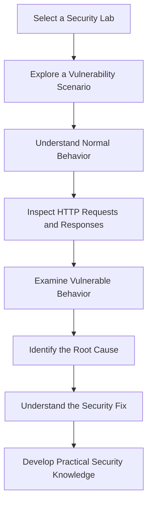
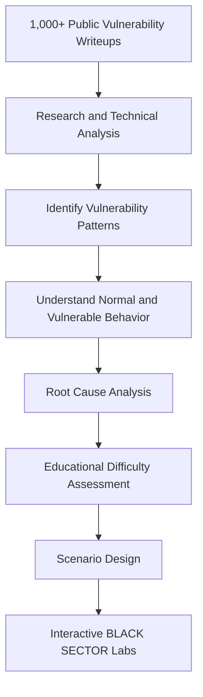
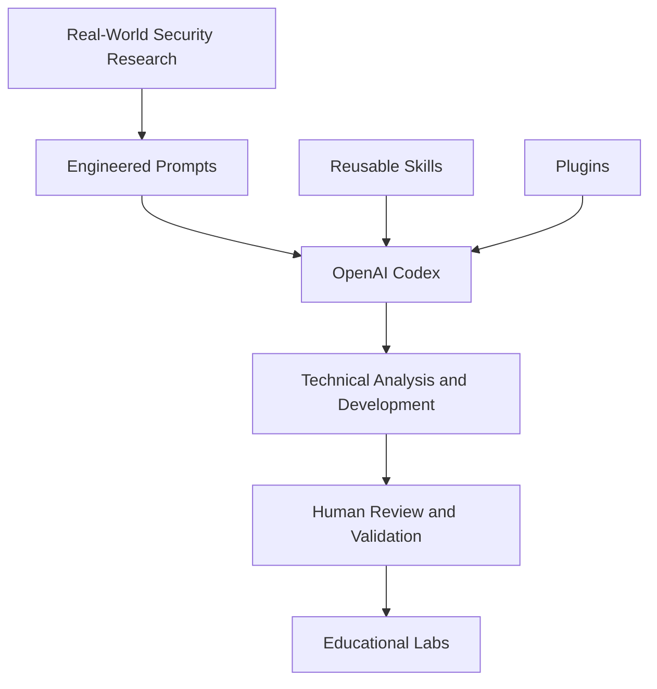
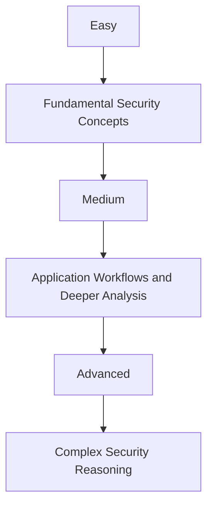
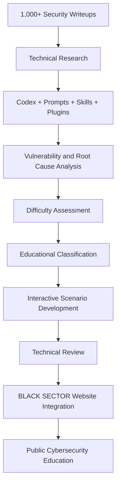

# BLACK SECTOR × OpenAI Codex

### From 1,000+ Real-World Vulnerability Writeups to Interactive Cybersecurity Labs

**Real Research · Engineered Prompts · Codex Skills & Plugins · Practical Cybersecurity Education**

BLACK SECTOR is an independent cybersecurity education platform that transforms real-world vulnerability research into structured, interactive learning experiences.

Through a carefully designed workflow using **OpenAI Codex, advanced prompt engineering, Skills, and Plugins**, we researched and analyzed more than **1,000 publicly available security vulnerability writeups**.

We used the findings to understand vulnerability patterns, identify technical root causes, assess educational difficulty, organize learning scenarios, and develop interactive cybersecurity Labs.

The resulting Labs were integrated directly into the BLACK SECTOR website and made publicly accessible for learning.

### Explore the Live Project

**[OPEN BLACK SECTOR INTERACTIVE LABS](https://blacksector.cc/labs/)**

**Official Website:** https://blacksector.cc

---

## Table of Contents

1. [Project Overview](#project-overview)
2. [What Are BLACK SECTOR Labs?](#what-are-black-sector-labs)
3. [The Research Foundation](#the-research-foundation)
4. [How We Used OpenAI Codex](#how-we-used-openai-codex)
5. [Prompt Engineering, Skills & Plugins](#prompt-engineering-skills--plugins)
6. [AI-Assisted Vulnerability Classification](#ai-assisted-vulnerability-classification)
7. [Inside an Interactive Lab](#inside-an-interactive-lab)
8. [Normal vs. Vulnerable Behavior](#normal-vs-vulnerable-behavior)
9. [Connecting Labs to Original Research](#connecting-labs-to-original-research)
10. [The Complete Development Workflow](#the-complete-development-workflow)
11. [From Research to a Public Platform](#from-research-to-a-public-platform)
12. [Educational Value](#educational-value)
13. [Technical Accuracy and Quality Control](#technical-accuracy-and-quality-control)
14. [Lessons Learned](#lessons-learned)
15. [Future Development](#future-development)
16. [Explore BLACK SECTOR](#explore-black-sector)

---

## Project Overview

### What Is BLACK SECTOR?

BLACK SECTOR is a cybersecurity education platform designed to help students, developers, penetration testers, and security enthusiasts develop a deeper understanding of real-world vulnerabilities.

Our educational philosophy is simple:

> Understand how an application is supposed to work before studying how it can fail.

Traditional vulnerability explanations often focus on exploitation techniques without fully explaining the application's intended functionality.

BLACK SECTOR approaches the problem differently.

We want learners to understand:

- How applications normally behave.
- Which security controls should exist.
- What changes when a vulnerability is introduced.
- Why the security weakness occurs.
- How the weakness can be identified.
- How the issue can be prevented.
- How similar vulnerabilities appear in different applications.

Our focus is on **technical understanding, practical analysis, and progressive learning**.

### Project Highlights

| Area | Description |
|---|---|
| Research | More than 1,000 real-world security writeups analyzed |
| AI Development | OpenAI Codex |
| Methodology | Engineered prompts, Skills, and Plugins |
| Education | Interactive cybersecurity Labs |
| Learning Model | Normal behavior vs. vulnerable behavior |
| Technical Depth | HTTP analysis, root causes, and fixes |
| Difficulty | Easy, Medium, and Advanced |
| Research Sources | Public vulnerability reports and writeups |
| Deployment | Integrated into BLACK SECTOR |
| Accessibility | Publicly accessible educational content |

**Note:** The 1,000+ figure refers to researched writeups, not the number of individual Labs or scenarios published.

---

## What Are BLACK SECTOR Labs?

BLACK SECTOR Labs are interactive educational modules designed to explain real-world cybersecurity vulnerabilities through structured technical scenarios.

Instead of presenting a vulnerability as a simple definition or a sequence of exploitation commands, each Lab explores the underlying application behavior.

A learner can investigate the context, understand the intended workflow, compare HTTP interactions, identify the vulnerability, and study its root cause.

### The Learning Model



### What Students Learn

Each relevant scenario aims to teach:

**Application Context**

What the application does and which functionality is involved.

**Expected Behavior**

How the application should respond under legitimate conditions.

**Vulnerable Behavior**

What happens when the application fails to enforce the intended security control.

**Technical Root Cause**

Which implementation mistake makes the vulnerability possible.

**HTTP Analysis**

How request and response differences reveal important security behavior.

**Security Remediation**

How developers can prevent or correct the underlying weakness.

### Explore the Educational Labs

**[Visit BLACK SECTOR Labs](https://blacksector.cc/labs/)**

---

## The Research Foundation

### More Than 1,000 Real-World Security Writeups

The foundation of our methodology is extensive research into publicly documented security vulnerabilities.

We researched and analyzed more than **1,000 published vulnerability writeups** to study real-world weaknesses, application behaviors, and recurring security patterns.

Our objective was not to reproduce the original reports.

Instead, we focused on extracting the underlying technical concepts that explain why vulnerabilities exist.

### Research Objectives

We investigated:

1. The affected application functionality.
2. The intended application workflow.
3. The security boundaries involved.
4. The conditions required for exploitation.
5. The vulnerable application behavior.
6. The underlying implementation mistake.
7. The technical root cause.
8. The expected secure behavior.
9. The educational complexity of the scenario.
10. The suitability of the vulnerability for interactive learning.

### Research-to-Education Model



### Research Quality Over Quantity

Analyzing more than 1,000 reports does not mean publishing 1,000 copies of existing writeups.

Some reports describe similar underlying weaknesses, while others reveal unique implementation mistakes.

Our methodology focuses on:

- Identifying valuable security concepts.
- Avoiding unnecessary duplication.
- Distinguishing real-world reports from illustrative examples.
- Preserving technical accuracy.
- Providing appropriate research attribution.
- Selecting scenarios with meaningful educational value.

The goal is to transform published research into understandable, practical learning experiences.

---

## How We Used OpenAI Codex

OpenAI Codex became an important part of our research and engineering workflow.

We used Codex to support technical analysis, scenario development, software implementation, troubleshooting, and quality review.

Rather than relying on generic instructions, we developed structured prompts with explicit technical requirements.

Our workflow combined:

- OpenAI Codex.
- Carefully engineered prompts.
- Reusable Skills.
- Plugins.
- Real-world vulnerability research.
- Technical validation.
- Human review.

### Codex as a Development Assistant

Codex supported tasks involving:

**Research Organization**

Structuring technical information and identifying relevant vulnerability concepts.

**Technical Analysis**

Assisting with the interpretation of vulnerability conditions, application behavior, and root causes.

**Scenario Design**

Helping translate technical findings into structured educational explanations.

**Software Development**

Supporting the implementation and refinement of interactive educational interfaces.

**Code Review**

Assisting with the identification of potential implementation problems and improvement opportunities.

**Troubleshooting**

Investigating development issues and exploring corrective approaches.

**Quality Improvement**

Supporting consistency checks, testing strategies, and iterative refinement.

Codex accelerated parts of the workflow, while technical decisions and validation remained subject to human review.

---

## Prompt Engineering, Skills & Plugins

### Why Prompt Engineering Mattered

A generic prompt such as:

> Create a vulnerability Lab.

does not provide enough technical or educational context.

Our requirements were more complex.

We needed a workflow capable of understanding the vulnerability, explaining expected application behavior, identifying the actual security failure, evaluating complexity, and preserving a consistent learning structure.

### Our Prompting Methodology

We designed prompts around several principles.

#### 1. Understand the Application

Establish the intended functionality before analyzing the security weakness.

#### 2. Identify the Vulnerability

Understand the conditions and behaviors responsible for the vulnerability.

#### 3. Determine the Root Cause

Focus on the underlying engineering mistake instead of simply reproducing exploitation steps.

#### 4. Compare Application Behavior

Distinguish expected, secure interactions from vulnerable interactions.

#### 5. Maintain Technical Accuracy

Require logically consistent technical explanations and HTTP examples.

#### 6. Evaluate Educational Difficulty

Assess the reasoning and technical knowledge required to understand each scenario.

#### 7. Preserve Consistency

Follow a structured educational format across different Labs.

#### 8. Review the Output

Treat AI-assisted analysis and generated code as material requiring independent technical review.

### Codex Skills

We used Skills to support reusable, specialized workflows.

These workflows helped maintain consistency across research, technical explanations, development, troubleshooting, and quality review activities.

The benefit of reusable Skills is that technical requirements do not have to be reconstructed for every individual task.

### Plugins

Plugins extended the capabilities available during relevant research and engineering activities.

They supported our broader approach of combining external technical information, structured analysis, and practical development.

### Combining the Components



This methodology helped us approach complex technical tasks more systematically.

**The objective was not simply to generate more content. It was to improve the consistency, depth, and educational value of the resulting Labs.**

---

## AI-Assisted Vulnerability Classification

A major part of our educational methodology is evaluating and organizing vulnerability scenarios according to difficulty.

We used structured Codex-assisted analysis to help assess the complexity of security scenarios and support their educational classification.

This process considers the technical reasoning required to understand each vulnerability.

### Why Difficulty Classification Matters

Cybersecurity learners do not all have the same level of experience.

An unstructured collection of security reports can expose beginners to complex exploitation conditions before they understand fundamental concepts.

We wanted learners to progress gradually.

### Learning Difficulty Levels

| Level | Focus | Expected Learning |
|---|---|---|
| Easy | Fundamental vulnerabilities | Understand direct security failures and clear behavioral differences |
| Medium | Intermediate application weaknesses | Analyze more complex workflows and subtle security mistakes |
| Advanced | Complex technical scenarios | Understand multiple conditions, deeper root causes, and advanced reasoning |

### Classification Criteria

Educational difficulty can depend on:

- Complexity of the application workflow.
- Technical knowledge required.
- Number of interacting conditions.
- Subtlety of the vulnerability.
- Difficulty of identifying the root cause.
- Complexity of the security boundaries.
- Amount of technical reasoning required.

### Difficulty Is Not Severity

An important distinction is that educational difficulty and security severity are not the same.

A high-impact vulnerability can be relatively straightforward to understand.

Likewise, a technically complex vulnerability may not have the highest security impact.

Our classification focuses on the learning challenge rather than simply assigning difficulty based on impact.

### Progressive Learning Model



### Educational Benefits

Difficulty classification helps learners:

- Select appropriate scenarios.
- Build foundational knowledge.
- Progress toward advanced material.
- Understand increasingly complex weaknesses.
- Develop analytical skills systematically.

**The objective is structured learning, not random exposure to exploitation techniques.**

---

## Inside an Interactive Lab

BLACK SECTOR organizes educational scenarios into a consistent learning experience.

### Lab Catalog

The public Lab catalog presents different cybersecurity topics and provides access to their scenarios.

Learners can choose the area they want to explore.

### Scenario Selection

Within a Lab, learners can navigate available scenarios and examine specific vulnerability concepts.

### Scenario Overview

Each relevant scenario provides context about the application behavior and the vulnerability being investigated.

### HTTP Requests and Responses

The educational interface allows learners to inspect and compare technical interactions.

These examples help establish the expected application behavior and illustrate how a vulnerable implementation differs.

### Root Cause Analysis

The technical explanation connects the observed behavior to the underlying implementation failure.

### Security Fix

Where relevant, learners can study the security control or implementation change needed to prevent the weakness.

### Learning Progression

Difficulty classification helps learners select scenarios that match their current technical understanding.

### Experience the Actual Interface

The interactive interface, scenario content, and HTTP examples are available on the live website.

**[OPEN THE LIVE LABS](https://blacksector.cc/labs/)**

---

## Normal vs. Vulnerable Behavior

Understanding the difference between normal and vulnerable application behavior is central to our approach.

A security weakness is easier to understand when the learner first understands what the application is supposed to do.

### Illustrative Example: Broken Access Control

Consider an application that allows authenticated users to retrieve account details.

A legitimate user requests information belonging to their account.

### Normal Request

```http
GET /api/accounts/1001 HTTP/1.1
Host: training.example
Authorization: Bearer USER_A_TOKEN
```

### Expected Response

```http
HTTP/1.1 200 OK
Content-Type: application/json

{
  "account_id": 1001,
  "owner": "user_a",
  "status": "active"
}
```

The application verifies the user's identity and checks whether they are authorized to access the requested resource.

### Vulnerable Request

The same user changes the account identifier to request a different account.

```http
GET /api/accounts/1002 HTTP/1.1
Host: training.example
Authorization: Bearer USER_A_TOKEN
```

### Vulnerable Response

```http
HTTP/1.1 200 OK
Content-Type: application/json

{
  "account_id": 1002,
  "owner": "user_b",
  "status": "active"
}
```

The application returns information belonging to another account without enforcing the required authorization check.

### Root Cause

The server validates authentication but fails to enforce resource-level authorization.

The security weakness exists because identifying the user does not automatically establish permission to access every resource.

### Secure Response

A secure implementation should reject unauthorized requests.

```http
HTTP/1.1 403 Forbidden
Content-Type: application/json

{
  "error": "Access denied"
}
```

### Behavior Comparison

| Component | Expected Behavior | Vulnerable Behavior |
|---|---|---|
| Authentication | User identity validated | User identity validated |
| Resource Ownership | Checked | Not correctly enforced |
| Authorization | Required | Missing or insufficient |
| Data Access | Authorized resources only | Unauthorized resources may be exposed |
| Result | Security boundary preserved | Security boundary violated |

### What the Learner Understands

- Authentication and authorization are different.
- Resource ownership must be validated.
- Changing an identifier should not bypass authorization.
- The vulnerable response exposes an authorization failure.
- The root cause is the missing resource-level access control.

This is a simplified illustrative example of the learning methodology, not an HTTP trace copied from a specific published vulnerability report.

The real BLACK SECTOR Labs contain their own scenarios and technical examples.

---

## Connecting Labs to Original Research

BLACK SECTOR aims to preserve the connection between educational scenarios and their original research context.

For report-backed cases, the published security writeup provides additional technical information about the vulnerability.

### Copy Link and Research References

The platform includes a **Copy link** feature associated with its educational scenario experience.

For report-backed scenarios linked to original research, the relevant published writeup serves as a reference that learners can explore.

This supports independent research and source verification.

Learners can use these references to:

- Read the original public vulnerability report.
- Understand the affected application's real-world context.
- Compare published findings with educational explanations.
- Explore additional technical details.
- Review the original researcher's observations.
- Strengthen independent security research skills.

### Why Attribution Matters

Our goal is not to replace published vulnerability research or claim ownership of original reports.

We use public research to understand security concepts and develop educational explanations.

Original reports remain the work of their respective researchers and publishers.

**Published Research → Technical Understanding → Interactive Educational Scenarios**

---

## The Complete Development Workflow

Our methodology connects security research with AI-assisted engineering and educational development.

### Stage 1 — Research Collection

Study publicly available vulnerability writeups and identify relevant security concepts.

### Stage 2 — Technical Analysis

Understand the affected functionality, expected behavior, exploitation conditions, and underlying root cause.

### Stage 3 — Codex-Assisted Analysis

Use carefully structured prompts, supported by relevant Skills and Plugins, to assist with organizing and analyzing technical information.

### Stage 4 — Difficulty Assessment

Evaluate the educational complexity of selected vulnerability scenarios.

### Stage 5 — Educational Classification

Organize scenarios into appropriate difficulty levels to support progressive learning.

### Stage 6 — Scenario Development

Translate vulnerability concepts into structured educational explanations, realistic HTTP interactions, and behavioral comparisons.

### Stage 7 — Software Implementation

Develop and refine the interactive learning experience using AI-assisted engineering workflows.

### Stage 8 — Technical Validation

Review vulnerability explanations, example requests and responses, functionality, and consistency.

### Stage 9 — Website Integration

Integrate the completed educational Labs into the BLACK SECTOR platform.

### Stage 10 — Public Release

Make the educational content accessible through the live website.

### Workflow Overview



**Research → Analysis → Classification → Development → Validation → Publication**

---

## From Research to a Public Platform

The final stage of the project was transforming the research and development work into a usable educational experience.

Rather than keeping the results as isolated documents or demonstrations, we integrated the educational Labs into the BLACK SECTOR website.

### Why Website Integration Matters

The website provides a centralized learning environment where students can:

- Browse vulnerability categories.
- Select individual security scenarios.
- Follow difficulty-based progression.
- Study expected application behavior.
- Examine vulnerable interactions.
- Compare HTTP requests and responses.
- Understand technical root causes.
- Explore relevant original research references.
- Learn about security controls and fixes.

### Public Accessibility

Our objective was to make the educational material available to people interested in cybersecurity learning.

The Labs can be accessed through the public BLACK SECTOR website.

The educational platform provides the interactive experience directly, while this repository documents the methodology used to develop it.

### Explore the Published Result

**[BLACK SECTOR — LIVE INTERACTIVE LABS](https://blacksector.cc/labs/)**

The repository is the technical and educational project overview.

The website is where learners can explore the actual Labs.

---

## Educational Value

### Learning Through Understanding

Our approach emphasizes the reasoning behind security weaknesses.

Students learn to identify relationships between intended functionality, unexpected behavior, and underlying implementation mistakes.

### Learning Through Comparison

Comparing normal and vulnerable behavior provides technical context that isolated exploitation examples may not offer.

### Learning Through Real Research

Public vulnerability writeups help connect educational material with security findings observed in real applications.

### Learning Through Progression

Difficulty classification provides a more organized path from fundamental concepts toward advanced security reasoning.

### Learning Through Technical Detail

HTTP requests, responses, root causes, and remediation explanations help learners understand how security concepts appear in actual application interactions.

---

## Who Is BLACK SECTOR For?

The platform is designed for:

- Cybersecurity students.
- Penetration testing learners.
- Security researchers.
- Bug bounty learners.
- Application security enthusiasts.
- Developers interested in secure software engineering.
- Advanced learners studying complex vulnerability patterns.

Our goal is to support practical understanding while keeping the educational content organized and technically meaningful.

---

## What Makes This Project Different?

### Research-Driven Content

The methodology draws on more than 1,000 real-world security writeups.

### Structured AI-Assisted Development

Codex, engineered prompts, Skills, and Plugins supported the research and engineering workflow.

### Root Cause-Focused Education

The Labs focus on why vulnerabilities occur rather than only how they can be reproduced.

### Behavioral Comparison

Learners study normal application functionality before examining vulnerable behavior.

### Progressive Classification

Scenarios are organized according to educational complexity to support structured learning.

### Research Attribution

Original public writeups provide additional context for research-backed educational scenarios.

### Interactive Learning

The material is integrated into a practical website rather than remaining isolated documentation.

### Continuous Improvement

The platform continues to evolve through research, technical review, and iterative development.

---

## Technical Accuracy and Quality Control

Cybersecurity education requires careful technical validation.

Our methodology emphasizes:

- Grounding research-backed scenarios in public technical findings.
- Distinguishing documented facts from illustrative examples.
- Reviewing vulnerability conditions.
- Checking technical explanations for logical consistency.
- Evaluating HTTP requests and responses.
- Identifying actual root causes.
- Maintaining consistent educational structure.
- Preserving appropriate source attribution.
- Avoiding unsupported technical claims.
- Restricting practical security testing to authorized environments.

### Human Review

Codex assists with technical work, but generated content and code are not automatically reliable.

Human review remains essential for assessing the accuracy, consistency, and educational value of the final material.

**AI-assisted development is a tool for improving engineering productivity, not a replacement for technical judgment.**

---

## Lessons Learned

### 1. Prompt Quality Matters

Well-defined objectives and technical constraints improve the usefulness and consistency of AI-assisted workflows.

### 2. Real-World Research Improves Educational Depth

Published vulnerability reports provide valuable insight into how security weaknesses arise in actual applications.

### 3. Root Cause Analysis Is Essential

Understanding why a vulnerability exists provides deeper knowledge than memorizing exploitation steps.

### 4. Difficulty Classification Helps Learners Progress

A structured progression allows students to build foundational skills before approaching more complex concepts.

### 5. Reusable Workflows Improve Consistency

Skills and structured prompting help maintain common quality requirements across related tasks.

### 6. AI Requires Verification

Technical explanations and implementations need independent evaluation, even when supported by capable AI tools.

### 7. Real Deployment Creates Practical Value

Publishing the results through an accessible platform allows research and development work to benefit actual learners.

---

## Future Development

BLACK SECTOR is an evolving educational project.

Our ongoing priorities include:

- Expanding high-quality research-backed educational scenarios.
- Improving technical explanations and root cause analysis.
- Refining difficulty classification.
- Maintaining consistent Lab interfaces.
- Improving platform performance and reliability.
- Continuing to explore advanced Codex-assisted engineering workflows.
- Developing reusable research and development practices.
- Sharing technical knowledge with the cybersecurity community.
- Exploring future AI-assisted capabilities for education and authorized security testing.

These are ongoing priorities and development directions, not claims that every planned capability has already been completed.

---

## Why We Are Sharing This Project

We want to demonstrate how AI-assisted development can contribute to practical cybersecurity education.

BLACK SECTOR combines:

**Cybersecurity Research · Software Engineering · Prompt Engineering · AI-Assisted Development · Educational Design**

Our experience demonstrates how extensive public security research can be transformed into a more structured learning experience with the support of OpenAI Codex.

We hope this project encourages developers and educators to explore responsible AI-assisted workflows while maintaining technical accuracy, research attribution, and human review.

We are especially interested in making advanced cybersecurity education more accessible to Arabic-speaking learners and the wider international technical community.

---

## Frequently Asked Questions

### Are there more than 1,000 Labs?

No.

The 1,000+ figure refers to the real-world vulnerability writeups researched and analyzed during the development process.

It does not represent the number of individual published Labs.

### Are all scenarios based on published reports?

The platform distinguishes research-backed scenarios from illustrative or hypothetical educational cases.

Not every educational example represents a direct reproduction of a publicly documented vulnerability.

### Does Codex automatically guarantee technical accuracy?

No.

Codex supports analysis and development, but technical content still requires independent validation and review.

### How are scenarios organized by difficulty?

Scenarios are assessed according to educational complexity, required technical knowledge, and the reasoning needed to understand the security weakness.

### Can learners access the Labs through GitHub?

GitHub provides the project documentation.

The actual interactive educational Labs are available through the BLACK SECTOR website.

### Where can I try the Labs?

Visit:

**https://blacksector.cc/labs/**

---

## Explore BLACK SECTOR

### Start Learning

The educational Labs are available through our official website.

**[OPEN BLACK SECTOR INTERACTIVE CYBERSECURITY LABS](https://blacksector.cc/labs/)**

### Project Links

| Resource | Link |
|---|---|
| Official Website | [blacksector.cc](https://blacksector.cc) |
| Interactive Labs | [BLACK SECTOR Labs](https://blacksector.cc/labs/) |
| Codex Community Documentation | [Community Repository](https://github.com/Ahmed80325/black-sector-codex-community) |

### Focus Areas

Cybersecurity Education · Real-World Vulnerability Research · Interactive Labs · OpenAI Codex · Prompt Engineering · Skills & Plugins · Root Cause Analysis · Progressive Learning

---

## Disclaimer

BLACK SECTOR is an independent cybersecurity education project.

It is not affiliated with, sponsored by, or endorsed by OpenAI.

References to OpenAI Codex, Skills, and Plugins describe tools used within our research and development workflow.

The educational material is intended for responsible learning and authorized security testing.

Original published vulnerability reports remain the work of their respective researchers and publishers.

---

## BLACK SECTOR — Learn. Build. Secure.

**From 1,000+ Real-World Security Writeups → Engineered Codex Workflows → Difficulty Classification → Interactive Security Labs → Public Cybersecurity Education.**

### Explore the Final Result

**[BLACK SECTOR — LIVE INTERACTIVE LABS](https://blacksector.cc/labs/)**

*Turning real-world cybersecurity research into practical education through structured analysis and AI-assisted engineering.*
